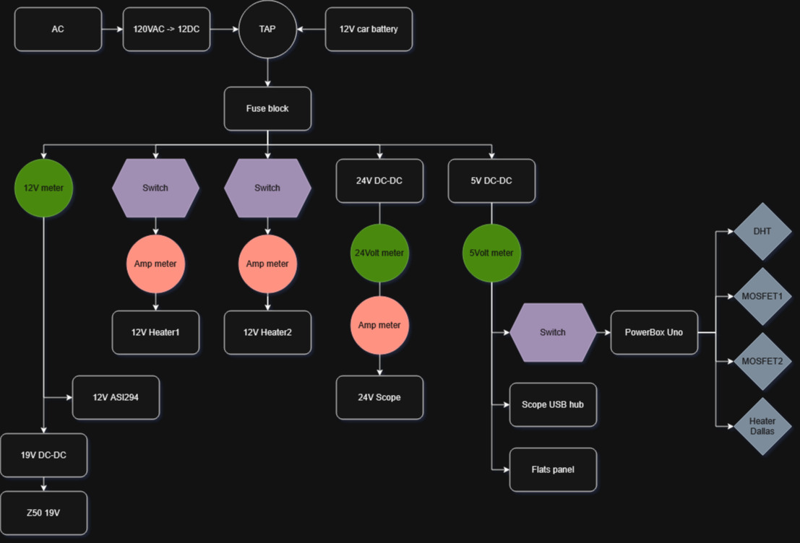

# PowerBox

By Michal Lemczyk.

The schematic, firmware and driver for an ASCOM-compatible telescope power
box: a temperature, voltage and current meter and a two-channel dew-heater
controller. It measures the rig's power rails and the conditions around the
telescope, keeps the optics above the dew point, and reports everything to a
simple web page and over ASCOM, so imaging software can log it or act on it.

## What it does

**Measures:**

| quantity | sensor | updated |
|---|---|---|
| Ambient temperature and humidity, and from them the dew point | DHT11 | every 4 s |
| Primary heater, secondary heater and mirror temperatures | 3 × DS18B20 (Dallas 1-Wire) probes | every 4 s |
| 5 V, 12 V and 24 V rail voltages | resistor dividers into the analog inputs | every loop |
| Telescope (24 V), primary heater and secondary heater current | 3 × hall-effect current sensors (0.185 V/A, ACS712-5A type) | every loop |

**Controls:**

- **Two dew heaters**, each switched by a MOSFET. A heater's duty cycle comes
  from where its own probe sits between the dew point and ambient: 100% at or
  below the dew point, 0% at or above ambient, and linear in between. A
  per-heater offset, adjustable from the web page, is added to that. A heater
  whose probe is unplugged is switched off.
- **A mirror fan** on a third MOSFET: on, off, or auto. In auto it runs while
  the mirror is warmer than ambient plus an adjustable offset, bringing the
  mirror down to air temperature.

**Reports:**

- **A web page** served by the board over Wi-Fi. It refreshes every 4 seconds
  and has links to change the settings (below).
- **An ASCOM Switch driver** for Windows, which reads the same page and
  presents every value as a read-only ASCOM switch.

## Hardware

| part | notes |
|---|---|
| Arduino UNO R4 WiFi | the "PowerBox Uno" in the diagram, on the switched 5 V rail |
| DHT11 | pin 13 |
| DS18B20 probes | 1-Wire bus on pin 6; one each on the primary heater, secondary heater and mirror |
| Current sensors | A0, A1, A2 (2.5 V output at zero current) |
| Voltage dividers | 24 V on A3, 12 V on A4, 5 V on A5; the divider ratios are in `MeterReader.cpp` |
| MOSFETs | primary heater pin 11, secondary heater pin 2, mirror fan pin 12 |

The diagram shows the power side: a 120 VAC → 12 VDC supply or a 12 V car
battery, a fuse block, and from it the metered 12 V rail (an ASI294 camera, and
a 19 V DC-DC converter for a Nikon Z50), two switched and metered 12 V heater
outputs, a 24 V DC-DC converter for the telescope, and a 5 V DC-DC converter
for the scope's USB hub, a flats panel and the PowerBox itself.

## The web page

`http://<box address>/` shows the readings and these controls:

| link | does |
|---|---|
| `/fanAuto`, `/fanOn`, `/fanOff` | mirror fan mode |
| `/fanInc`, `/fanDec` | mirror fan threshold above ambient, ±0.5 °C |
| `/priInc`, `/priDec` | primary heater duty-cycle offset, ±1% |
| `/secInc`, `/secDec` | secondary heater duty-cycle offset, ±1% |
| `/rstAvg` | reset the running heater-vs-ambient averages |

The page starts with a row of 16 space-separated numbers. That row is the data
the ASCOM driver reads, by position:

`dewPoint ambient 5V 12V 24V scopeA primaryA secondaryA primaryC secondaryC mirrorC primaryDuty% secondaryDuty% mirrorDuty% fanMode millis`

## The ASCOM driver

`ASCOM_driver/` is a local-server (`.exe`) ASCOM Switch driver, ProgID
`ASCOM.PowerBox.Switch`, built on the ASCOM Platform's driver template for .NET
Framework 4.7.2. It polls the box over HTTP and exposes 23 read-only switches:
dew point, ambient, the three probe temperatures, the three rail voltages, the
three currents, the three duty cycles, the fan mode, and running averages of
each probe's difference from ambient. Switches named `---` are spacers.

## Building and setup

**Firmware** ([PlatformIO](https://platformio.org/), environment `uno_r4_wifi`):

1. Copy `Arduino/PowerBox/src/arduino_secrets.example.h` to
   `arduino_secrets.h` in the same folder and put in your Wi-Fi network name and
   password. That file is git-ignored.
2. Set the box's address: `IPAddress ip(...)` in `Arduino/PowerBox/src/WebServer.cpp`.
3. From `Arduino/PowerBox/`: `pio run -e uno_r4_wifi -t upload`.

**Driver** (Windows, with the [ASCOM Platform](https://ascom-standards.org/)
installed): open `ASCOM_driver/PowerBox/PowerBox.sln` in Visual Studio, set the
same address in `SwitchHardware..cs` (`updateValues()`), build, and run the
`.exe` once with `/regserver` as administrator to register it. It then appears
in any ASCOM client's chooser as a Switch device.

The address is set in both places because the box uses a fixed IP and the
driver has no setting for it yet.

## Repo layout

| path | what |
|---|---|
| `PowerBox.jpg` | the power-distribution diagram |
| `Arduino/PowerBox/` | the firmware (PlatformIO project) |
| `Arduino/referenceImpl.txt` | the Arduino Wi-Fi web server example the firmware started from |
| `ASCOM_driver/PowerBox/` | the ASCOM Switch driver (Visual Studio solution) |

## How this was built

I designed and built the box and wrote the firmware and the ASCOM driver, the
driver starting from the ASCOM Platform's Switch driver template. The repo was
prepared for publication with [Claude Code](https://claude.com/claude-code),
Anthropic's AI coding agent: moving the Wi-Fi credentials out of the code,
keeping the driver's data line working alongside a new human-readable page
(the firmware was compiled to check), and writing this README and
[`CLAUDE.md`](CLAUDE.md). Commits it helped write carry a
`Co-Authored-By: Claude` line.

## License

Public domain, under the [Unlicense](LICENSE).
